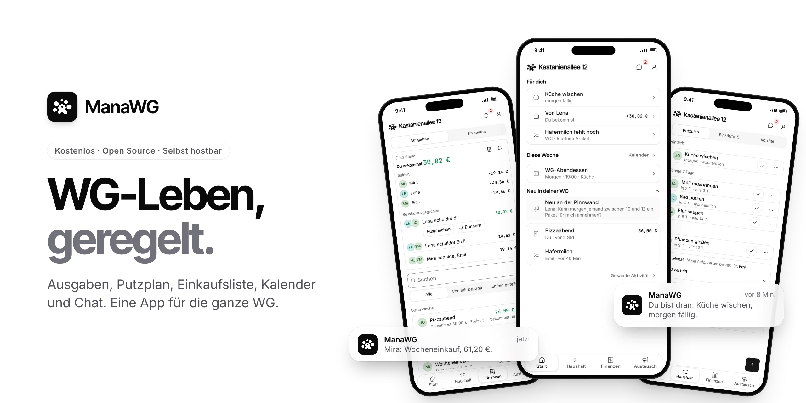
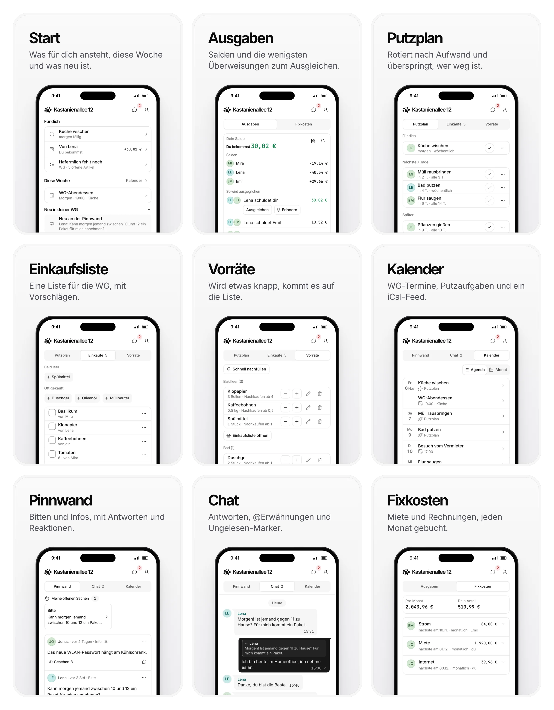

<p align="center">
  <a href="https://manawg.com">
    <picture>
      <source media="(prefers-color-scheme: dark)" srcset="docs/screenshots/cover-de-dark.webp">
      
    </picture>
  </a>
</p>

<h3 align="center">Eine App für die ganze WG: Ausgaben, Putzplan, Einkaufsliste, Kalender und Chat.</h3>

<p align="center">
  <a href="https://app.manawg.com"><strong>App öffnen</strong></a> ·
  <a href="https://manawg.com/demo"><strong>Demo ausprobieren</strong></a> ·
  <a href="#selbst-hosten">Selbst hosten</a> ·
  <a href="https://manawg.com">Website</a> ·
  <a href="docs/README.md">Doku</a> ·
  <a href="https://github.com/Abuarchiv/manawg/discussions">Discussions</a>
</p>

<p align="center"><a href="README.md">English</a> · <strong>Deutsch</strong></p>

<p align="center">
  <a href="https://github.com/Abuarchiv/manawg/releases/latest"></a>
  <a href="https://github.com/Abuarchiv/manawg/pkgs/container/manawg"></a>
  <a href="https://github.com/Abuarchiv/manawg/actions/workflows/ci.yml"></a>
  <a href="LICENSE"></a>
</p>

ManaWG ist eine kostenlose Open-Source-App für Wohngemeinschaften. Ihr teilt Ausgaben, wechselt
euch beim Putzen ab, führt eine gemeinsame Einkaufsliste, plant Termine und schreibt im Chat,
ohne Kostenrechner, Putz-App und Gruppenchat nebeneinander. Die App läuft im Browser und lässt
sich auf Android und iPhone als Web-App installieren. Sie spricht Deutsch und Englisch, passend
zur Sprache des Geräts.

- **Kostenlos:** Die gehostete Version auf [app.manawg.com](https://app.manawg.com) hat keine
  Werbung, keine Tracking-Cookies und kein Bezahl-Abo.
- **Selbst betreibbar:** Ein `docker compose up` startet deine eigene Instanz, auf einem kleinen
  Server oder einem Raspberry Pi (Images für amd64 und arm64).
- **Funktioniert offline:** Änderungen ohne Verbindung werden gesammelt und später ohne Duplikate
  übertragen.
- **Kein Lock-in:** Du kannst die ganze WG jederzeit als JSON oder CSV exportieren.

## Funktionen

<picture>
  <source media="(prefers-color-scheme: dark)" srcset="docs/screenshots/features-de-dark.webp">
  
</picture>

| Bereich | Was es kann |
| --- | --- |
| **Ausgaben** | Gleichmäßig oder nach Betrag teilen, in EUR, CHF, USD oder GBP. Salden, Vorschläge zum Ausgleichen mit möglichst wenigen Überweisungen, Barzahlungen, Zahlungserinnerungen und Fixkosten wie die Miete. Jeden Monat kommt eine Abrechnung per Mail mit PDF im Anhang. |
| **Putzplan** | Aufgaben rotieren nach Aufwand: Wer am wenigsten zu tun hat, ist als Nächstes dran, und niemand bekommt dieselbe Aufgabe zweimal hintereinander. Wer verreist ist, wird übersprungen. |
| **Einkauf und Vorräte** | Eine gemeinsame Liste mit Vorschlägen und Vorräte, die einen Artikel auf die Liste setzen, sobald er knapp wird. |
| **Kalender** | Wiederkehrende Termine, Erinnerungen und ein iCal-Feed für den Kalender auf dem Handy. |
| **Pinnwand und Chat** | Ankündigungen mit Kommentaren und Reaktionen und ein Chat mit Antworten und @Erwähnungen. |
| **Überall** | Push-Benachrichtigungen, heller und dunkler Modus, Deutsch und Englisch je nach Gerätesprache. |

ManaWG ist für eine WG mit bis zu 20 Personen gebaut. Reisen, Büros und Vermieter gehören nicht
dazu.

### Umzug von Splitwise oder Splid

Exportiere eine CSV-Datei aus Splitwise oder Splid und importiere sie unter *Ausgaben → Import*.
ManaWG ordnet die Namen deinen Mitbewohnern zu, überspringt Zeilen, die es schon gibt, und kann
einen ganzen Import rückgängig machen. Ausgaben lassen sich auch aus einem Screenshot lesen; die
Texterkennung läuft in deinem Browser, das Bild verlässt dein Gerät also nicht.

## Selbst hosten

Du brauchst Docker mit Compose v2, `git` und `openssl`. Eine laufende Instanz braucht etwa 500 MB
Arbeitsspeicher.

```sh
git clone https://github.com/Abuarchiv/manawg.git
cd manawg
./docker/setup.sh        # schreibt .env mit frischen Secrets
docker compose up -d
```

Öffne [localhost](http://localhost) und registriere dich. Der Anmeldecode landet in Mailpit unter
[localhost:8025](http://localhost:8025). Der Stack startet die App, PostgreSQL, die Anmeldung, den
Bildspeicher, ein HTTPS-Gateway und den Mail-Fänger und lädt das Image des neuesten Releases.

Zum Aktualisieren setzt du `MANAWG_VERSION` in `.env` auf das neue Release (oder auf `0.1`, um
dessen Fehlerbehebungen zu folgen) und führst `docker compose pull && docker compose up -d` aus.
Migrationen laufen beim Start. [CHANGELOG.md](CHANGELOG.md) listet jede Änderung und sagt, wann
ein Update einen Handgriff braucht.

Die [Anleitung zum Selbst-Hosten](docs/self-hosting.md) (Englisch) erklärt eine eigene Domain mit
HTTPS, echten Mailversand, Google-Anmeldung, Backups und Wiederherstellung sowie den Betrieb auf
Vercel und Supabase statt Docker.

## KI-Assistenten verbinden

Mit dem [ManaWG-MCP-Server](https://github.com/Abuarchiv/manawg-mcp) können Claude, ChatGPT oder
ein anderer MCP-Client deine WG lesen und für dich ändern, zum Beispiel eine Ausgabe eintragen
oder etwas auf die Einkaufsliste setzen. Er meldet sich per OAuth an, und du kannst ihn unter
*Einstellungen → Zugang* wieder trennen.

## Entwicklung

Im Fixture-Modus kommen Beispiel-WGs aus dem Speicher, du brauchst also weder Datenbank noch
Konten. Mit Node 22:

```sh
corepack enable          # ab Node 25 vorher: npm install -g corepack
pnpm install
pnpm --filter @manawg/web dev:fixtures
```

Dann öffne [localhost:3000/wg/MTE8PZAT](http://localhost:3000/wg/MTE8PZAT). Alternativ startest du
in [GitHub Codespaces](https://codespaces.new/Abuarchiv/manawg), dort ist alles schon installiert.
[Architektur](docs/architecture.md) und [Entwicklung](docs/development.md) (beide Englisch)
erklären den Aufbau, alle Befehle, Tests und CI-Prüfungen.

## Mitmachen

Fehlerberichte, Fixes, Übersetzungen und Doku sind willkommen. Lies vor deinem ersten Pull Request
[CONTRIBUTING.md](CONTRIBUTING.md) und stimme den Ansatz in einem Issue ab, bevor du ein Feature
baust. Issues mit dem Label
[good first issue](https://github.com/Abuarchiv/manawg/labels/good%20first%20issue) eignen sich
gut für den Einstieg.

- Feature-Wünsche werden
  [nach 👍-Stimmen sortiert](https://github.com/Abuarchiv/manawg/issues?q=is%3Aissue+is%3Aopen+label%3Aenhancement+sort%3Areactions-%2B1-desc).
- Fragen und Ideen gehören in die [Discussions](https://github.com/Abuarchiv/manawg/discussions).
- Sicherheitsprobleme meldest du vertraulich, wie in [SECURITY.md](SECURITY.md) beschrieben.
- Nutzt ihr ManaWG in eurer WG? Erzählt es unter
  [Show and tell](https://github.com/Abuarchiv/manawg/discussions/categories/show-and-tell).

Wenn dir ManaWG hilft, hilft ein Stern anderen WGs, es zu finden.

## Lizenz

[Apache License 2.0](LICENSE). Komponenten Dritter und ihre Lizenzen stehen in
[THIRD-PARTY-NOTICES.md](THIRD-PARTY-NOTICES.md).
