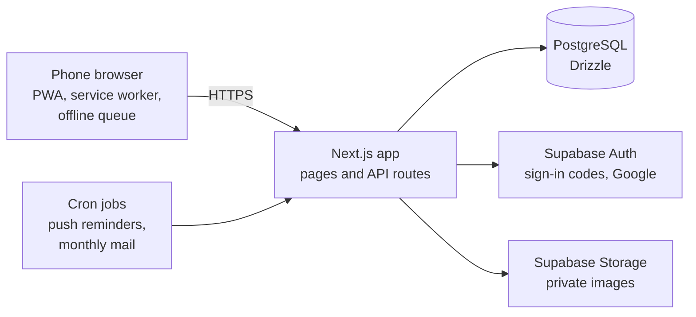

<p align="center"></p>

<h1 align="center">ManaWG</h1>

<p align="center">
  <strong>The free, open-source app for shared flats: split expenses, rotate chores, share the shopping list.</strong>
</p>

<p align="center">
  <a href="https://app.manawg.com"><strong>Try it</strong></a> ·
  <a href="#self-hosting">Self-host</a> ·
  <a href="#contributing">Contribute</a> ·
  <a href="docs/README.md">Docs</a> ·
  <a href="https://github.com/Abuarchiv/manawg/discussions">Discussions</a> ·
  <a href="https://manawg.com">Website</a>
</p>

<p align="center">
  <a href="https://github.com/Abuarchiv/manawg/actions/workflows/ci.yml"></a>
  <a href="LICENSE"></a>
  <a href="#self-hosting"></a>
  <a href="https://scorecard.dev/viewer/?uri=github.com/Abuarchiv/manawg"></a>
  <a href="https://codespaces.new/Abuarchiv/manawg"></a>
</p>

<p align="center">
  
  
  
  
</p>

ManaWG keeps the expenses, chores, shopping list and calendar of a shared flat in one app. A *WG*
(*Wohngemeinschaft*) is the German word for a shared flat. Use it for free at
[app.manawg.com](https://app.manawg.com), or run your own instance with Docker.

## Features

**Money**

- Split expenses evenly or by custom amounts and see who owes whom.
- Settle up with as few transfers as possible, and send payment reminders.
- Recurring costs such as rent and utilities, and a monthly statement by mail.
- Import from Splitwise or Splid (CSV), or from a screenshot; the text recognition runs in your
  browser.

**Chores**

- A cleaning rota that rotates between flatmates and takes absences into account.
- Reminders for chores that are due.

**Shared life**

- One shopping list for the flat, plus a list of household supplies.
- A shared calendar with recurring dates, reminders and an iCal feed for your calendar app.
- A flat chat and a pinboard for announcements.

**On your phone**

- Installs from the browser as an app (PWA) on Android and iPhone, with push notifications.
- Works offline: new expenses, chores, shopping items and announcements wait on the phone and are
  sent once you are back online, without creating duplicates.
- English and German, following your device language.

**Your data**

- Export a WG as JSON or CSV, and delete your account at any time.
- No ads and no tracking cookies. On a self-hosted instance, error reporting and analytics stay off
  unless you configure them.

## Why ManaWG

A typical flat uses a bill splitter such as Splitwise for the money, a chore app for the cleaning
rota and a group chat for everything else. That works, but the pieces do not know about each
other: the person who is away still gets the bathroom, and the shopping list lives in a chat
scroll. ManaWG keeps expenses, chores, shopping, calendar and chat in one app for one flat.

If you only need to split bills and your flat already likes Splitwise, you can import your history
and try ManaWG next to it.

### Principles

- **Phone first.** Flatmates use it standing in the kitchen or the supermarket. Every screen is
  one column, on every screen size.
- **Small on purpose.** ManaWG is for one flat of up to 20 people, not for trips, offices or
  landlords. New features have to fit that.
- **Money is exact.** Amounts are integer cents, splits always add up to the total, and a request
  retried over a bad connection is never booked twice.
- **Private by default.** No ads, cookieless and minimal analytics on the hosted instance, none on
  yours.

## Self-hosting

A whole instance (app, database, sign-in, image storage, mail catcher) runs on any machine with
Docker:

```sh
git clone https://github.com/Abuarchiv/manawg.git
cd manawg
./docker/setup.sh            # creates .env with fresh secrets
docker compose up -d
```

The first start builds the app image, which takes about ten minutes. Then open
[http://localhost](http://localhost) and create an account; the sign-in code arrives in Mailpit at
[http://localhost:8025](http://localhost:8025).

The [self-hosting guide](docs/self-hosting.md) covers a public instance with your own domain and
HTTPS, mail, Google sign-in, updates, backups, and the alternative setup on Vercel and Supabase.

## Develop

You need neither a database nor accounts. Fixture mode serves a sample WG from memory.

**In the browser:** open the repository in
[GitHub Codespaces](https://codespaces.new/Abuarchiv/manawg) (or any dev container) and run the
last command below.

**On your machine,** with Node 22 and pnpm 9:

```sh
corepack enable
pnpm install
pnpm --filter @manawg/web dev:fixtures
```

Then open [localhost:3000/wg/MTE8PZAT](http://localhost:3000/wg/MTE8PZAT).
[docs/development.md](docs/development.md) lists all commands, tests and quality gates.

### How it fits together



| Layer | Used |
| --- | --- |
| App | Next.js 16, React 19, TypeScript, Tailwind CSS 4, installable PWA |
| Data | PostgreSQL with Drizzle ORM, versioned SQL migrations |
| Accounts and files | Supabase Auth and Storage |
| Tests | `node:test` unit tests, Playwright end to end |
| Self-hosting | Docker Compose with Caddy |

[docs/architecture.md](docs/architecture.md) explains the layers, the money model, idempotency
and the offline queue.

## Project status

ManaWG is in daily use at [app.manawg.com](https://app.manawg.com). There are no versioned
releases yet: `main` is always deployable, the hosted instance runs it, and self-hosted instances
update by pulling `main` (see [Updating](docs/self-hosting.md#updating)); new database migrations
are applied automatically before the new version starts.

Ideas and plans are discussed openly in
[Discussions → Ideas](https://github.com/Abuarchiv/manawg/discussions/categories/ideas).

## Contributing

Contributions are welcome: code, bug reports, documentation, translations and ideas. Criticism too:
if something is confusing, slow or wrong, an issue about it is a contribution.

- **Start small.** Issues labelled
  [good first issue](https://github.com/Abuarchiv/manawg/labels/good%20first%20issue) are
  small and written up for a first pull request. When none are open, start a Discussion or open an
  issue first.
- **Pick something bigger.** Issues labelled
  [help wanted](https://github.com/Abuarchiv/manawg/labels/help%20wanted) are open to anyone.
- **Translate.** All texts live in two catalogs; see
  [Texts and translations](CONTRIBUTING.md#texts-and-translations).

[CONTRIBUTING.md](CONTRIBUTING.md) walks through your first pull request. The website
[manawg.com](https://manawg.com) is open source as well, in
[Abuarchiv/manawg-landing](https://github.com/Abuarchiv/manawg-landing).

If ManaWG is useful to your flat, a star helps other flats find it.

## Community and support

- **Questions and ideas:** [Discussions](https://github.com/Abuarchiv/manawg/discussions).
- **Help and bug reports:** see [SUPPORT](.github/SUPPORT.md).
- **Security:** report vulnerabilities privately, see [SECURITY.md](SECURITY.md).
- **Conduct:** everyone taking part follows the [Code of Conduct](CODE_OF_CONDUCT.md).

## License

ManaWG is licensed under the [Apache License 2.0](LICENSE). Third-party components and their
licences: [THIRD-PARTY-NOTICES.md](THIRD-PARTY-NOTICES.md).
