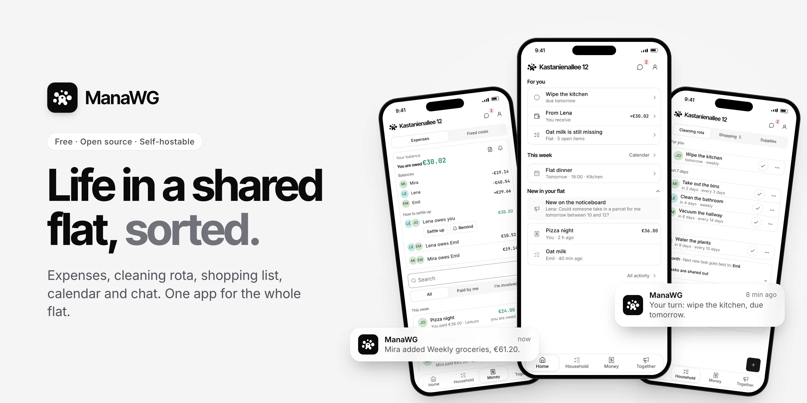
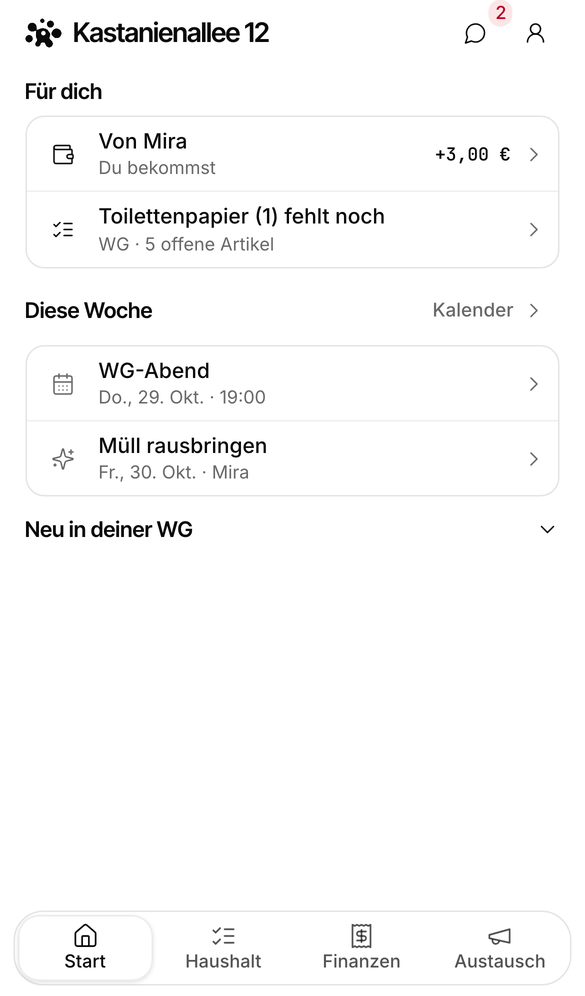
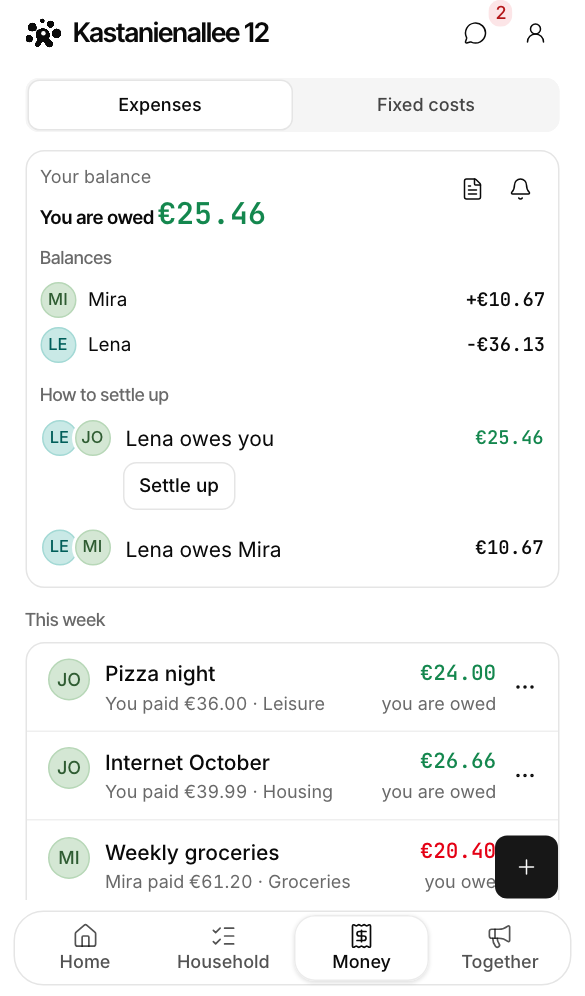
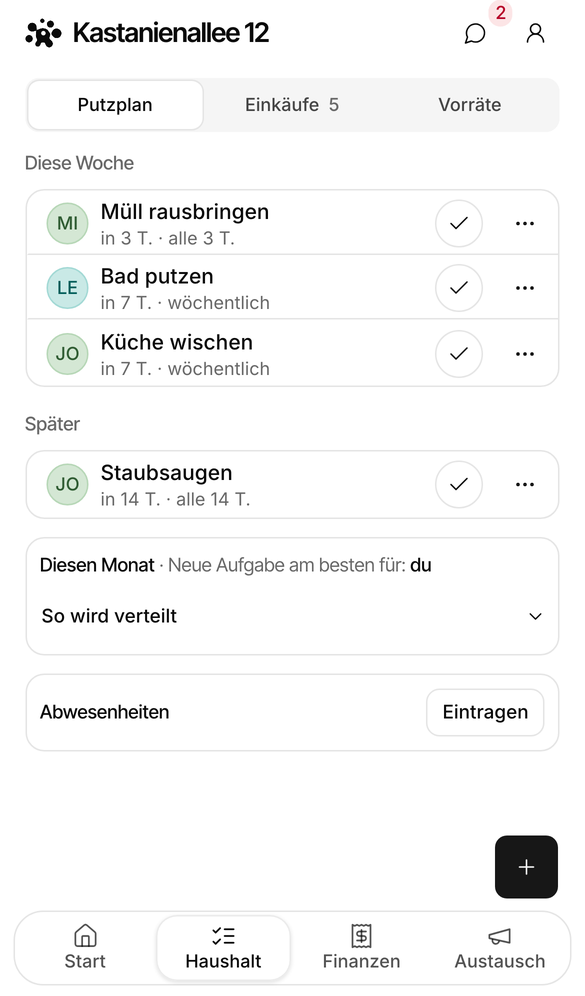
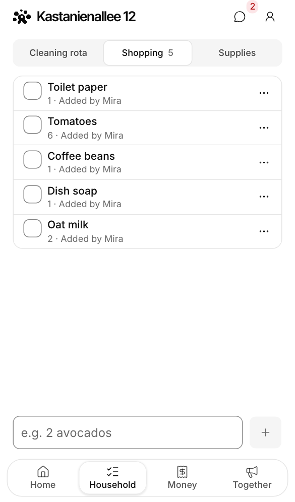

<p align="center">
  <a href="https://manawg.com/en">
    <picture>
      <source media="(prefers-color-scheme: dark)" srcset="docs/screenshots/cover-dark.webp">
      
    </picture>
  </a>
</p>

<p align="center">
  <a href="https://app.manawg.com">App</a> ·
  <a href="https://manawg.com/en">Website</a> ·
  <a href="docs/README.md">Docs</a> ·
  <a href="https://github.com/Abuarchiv/manawg/discussions">Discussions</a>
</p>

<p align="center">
  <a href="https://github.com/Abuarchiv/manawg/actions/workflows/ci.yml"></a>
  <a href="LICENSE"></a>
  <a href="https://scorecard.dev/viewer/?uri=github.com/Abuarchiv/manawg"></a>
</p>

ManaWG is a free, open-source app for shared flats. Flatmates use it to split expenses, rotate
the cleaning, keep a shared shopping list, plan dates and chat. It runs in the browser and installs
on Android and iPhone as a progressive web app. *WG* is short for *Wohngemeinschaft*, German for
shared flat.

You can use the hosted instance at [app.manawg.com](https://app.manawg.com) for free, or run your
own with Docker Compose.

## Features

<p align="center">
  
  
  
  
</p>

- Expenses split evenly or by amount, balances, settle-up suggestions with as few transfers as
  possible, payment reminders and recurring costs such as rent.
- A monthly statement by mail, and import from Splitwise or Splid (CSV) or from a screenshot. Text
  recognition runs in the browser.
- A cleaning rota that rotates chores and skips flatmates who are away.
- Shopping list, household supplies, pinboard and chat.
- Calendar with recurring dates, reminders and an iCal feed.
- Push notifications, and offline use: changes made without a connection sync later without
  duplicates.
- English and German, following the device language.
- Export of a WG as JSON or CSV. No ads and no tracking cookies.

ManaWG is built for one flat of up to 20 people. Trips, offices and landlords are out of scope.

## Self-hosting

You need Docker with Compose v2, `git` and `openssl`:

```sh
git clone https://github.com/Abuarchiv/manawg.git
cd manawg
./docker/setup.sh        # writes .env with fresh secrets
docker compose up -d
```

The stack runs the app, PostgreSQL, sign-in, image storage and a mail catcher. Until there are
published images, the first start builds the app from your checkout, which takes about ten
minutes. Then open [localhost](http://localhost) and sign up; the sign-in code arrives in Mailpit at
[localhost:8025](http://localhost:8025).

The [self-hosting guide](docs/self-hosting.md) covers a public domain with HTTPS, real mail,
Google sign-in, updates and backups, and a setup on Vercel and Supabase instead of Docker.

## Development

Fixture mode serves sample WGs from memory, so you need no database and no accounts. With Node 22:

```sh
corepack enable          # Node 25 and later: npm install -g corepack first
pnpm install
pnpm --filter @manawg/web dev:fixtures
```

Then open [localhost:3000/wg/MTE8PZAT](http://localhost:3000/wg/MTE8PZAT). You can also open the
repository in [GitHub Codespaces](https://codespaces.new/Abuarchiv/manawg), which installs
everything.

The app is Next.js 16 with React 19 and TypeScript, PostgreSQL through Drizzle, and Supabase for
sign-in and file storage. [Architecture](docs/architecture.md) explains how it fits together,
including the money model and the offline queue. [Development](docs/development.md) lists all
commands, tests and CI checks.

## Contributing

Bug reports, fixes, translations and documentation are welcome. Read
[CONTRIBUTING.md](CONTRIBUTING.md) before your first pull request, and open an issue to agree on
the approach before you build a feature. Issues labelled
[good first issue](https://github.com/Abuarchiv/manawg/labels/good%20first%20issue) are a good
place to start.

Feature requests are
[ranked by 👍 votes](https://github.com/Abuarchiv/manawg/issues?q=is%3Aissue+is%3Aopen+label%3Aenhancement+sort%3Areactions-%2B1-desc).
Questions go to [Discussions](https://github.com/Abuarchiv/manawg/discussions), and security
problems are reported privately as described in [SECURITY.md](SECURITY.md).

Related repositories: the website [manawg-landing](https://github.com/Abuarchiv/manawg-landing) and
the MCP server [manawg-mcp](https://github.com/Abuarchiv/manawg-mcp).

## License

[Apache License 2.0](LICENSE). Third-party components and their licences are listed in
[THIRD-PARTY-NOTICES.md](THIRD-PARTY-NOTICES.md).
