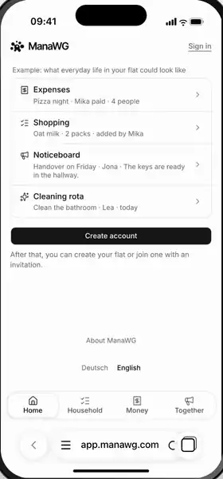
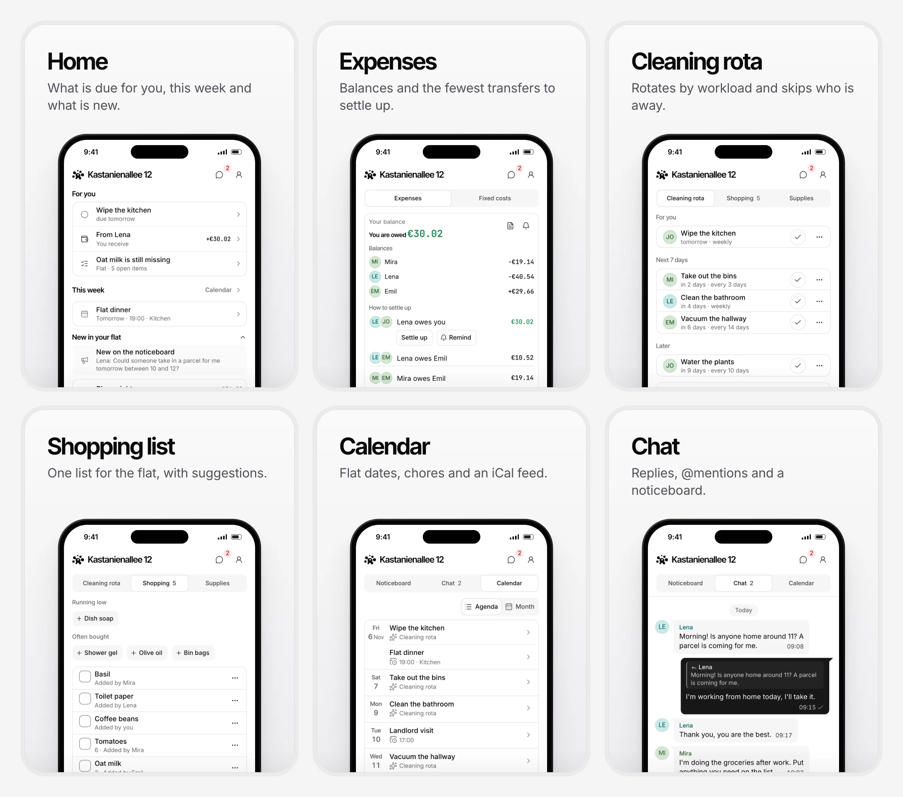

<p align="center">
  <a href="https://manawg.com/en">
    <picture>
      <source media="(prefers-color-scheme: dark)" srcset="docs/screenshots/cover-dark.webp">
      
    </picture>
  </a>
</p>

<h3 align="center">One app for the whole flat: expenses, cleaning rota, shopping list, calendar and chat.</h3>

<p align="center">
  <a href="https://manawg.com/en/demo"><strong>Try the demo</strong></a> (no account) ·
  <a href="https://app.manawg.com"><strong>Open the app</strong></a> ·
  <a href="#self-hosting">Self-host</a> ·
  <a href="https://manawg.com/en">Website</a> ·
  <a href="docs/README.md">Docs</a> ·
  <a href="https://github.com/Abuarchiv/manawg/discussions">Discussions</a>
</p>

<p align="center"><strong>English</strong> · <a href="README.de.md">Deutsch</a></p>

<p align="center">
  <a href="https://github.com/Abuarchiv/manawg/releases/latest"></a>
  <a href="https://github.com/Abuarchiv/manawg/pkgs/container/manawg"></a>
  <a href="https://github.com/Abuarchiv/manawg/actions/workflows/ci.yml"></a>
  <a href="LICENSE"></a>
</p>

ManaWG is a free, open-source app for shared flats. Flatmates split expenses, take turns with the
cleaning, keep one shopping list, plan dates and chat, without juggling a bill splitter, a chore
app and a group chat. It runs in the browser and installs on Android and iPhone as a progressive
web app. *WG* is short for *Wohngemeinschaft*, German for shared flat.

- **Free to use:** the hosted instance at [app.manawg.com](https://app.manawg.com) has no ads, no
  tracking cookies and no paid tier.
- **Yours to run:** one `docker compose up` starts your own instance, on a small server or a
  Raspberry Pi (images for amd64 and arm64).
- **Works offline:** changes made without a connection are queued and sync later, without
  duplicates.
- **Easy to leave:** export the whole flat as JSON or CSV at any time.

<p align="center">
  <picture>
    <source media="(prefers-color-scheme: dark)" srcset="docs/screenshots/demo-en-dark.webp">
    
  </picture>
</p>

## Features

<picture>
  <source media="(prefers-color-scheme: dark)" srcset="docs/screenshots/features-dark.webp">
  
</picture>

| Area | What it does |
| --- | --- |
| **Expenses** | Split evenly or by amount in EUR, CHF, USD or GBP. Balances, settle-up suggestions with as few transfers as possible, cash payments, payment reminders and recurring costs such as rent. A monthly statement arrives by mail with a PDF attached. |
| **Cleaning rota** | Chores rotate by workload, so the person with the lightest load is next and nobody gets the same chore twice in a row. Flatmates who are away are skipped. |
| **Shopping and supplies** | One shared list with suggestions, and household supplies that put an item on the list when it runs low. |
| **Calendar** | Recurring dates, reminders and an iCal feed for your phone's calendar. |
| **Pinboard and chat** | Announcements with comments and reactions, and a chat with replies and @mentions. |
| **Everywhere** | Push notifications, light and dark mode, English and German following the device language. |

ManaWG is built for one flat of up to 20 people. Trips, offices and landlords are out of scope.

### Moving from Splitwise or Splid

Export a CSV from Splitwise or Splid and import it under *Expenses → Import*. ManaWG matches the
names to your flatmates, skips rows it already has and can undo a whole import. It can also read
expenses from a screenshot; the text recognition runs in your browser, so the image never leaves
your device.

## Self-hosting

You need Docker with Compose v2, `git` and `openssl`. A running instance uses about 500 MB of
memory.

```sh
git clone https://github.com/Abuarchiv/manawg.git
cd manawg
./docker/setup.sh        # writes .env with fresh secrets
docker compose up -d
```

Open [localhost](http://localhost) and sign up. The sign-in code arrives in Mailpit at
[localhost:8025](http://localhost:8025). The stack runs the app, PostgreSQL, sign-in, image
storage, an HTTPS gateway and the mail catcher, and pulls the image of the latest release.

To update, set `MANAWG_VERSION` in `.env` to the new release (or to `0.1` to follow its bug-fix
releases) and run `docker compose pull && docker compose up -d`. Migrations run on start.
[CHANGELOG.md](CHANGELOG.md) lists every change and says when an update needs a manual step.

The [self-hosting guide](docs/self-hosting.md) covers a public domain with HTTPS, real mail,
Google sign-in, backups and restore, and a setup on Vercel and Supabase instead of Docker.

## Connect an AI assistant

The [ManaWG MCP server](https://github.com/Abuarchiv/manawg-mcp) lets Claude, ChatGPT or another
MCP client read and update your flat on your behalf, for example to add an expense or put
something on the shopping list. It signs in with OAuth, and you can disconnect it under
*Settings → Access*.

## Development

Fixture mode serves sample flats from memory, so you need no database and no accounts. With
Node 22:

```sh
corepack enable          # Node 25 and later: npm install -g corepack first
pnpm install
pnpm --filter @manawg/web dev:fixtures
```

Then open [localhost:3000/wg/MTE8PZAT](http://localhost:3000/wg/MTE8PZAT). You can also start in
[GitHub Codespaces](https://codespaces.new/Abuarchiv/manawg), which installs everything.

| Part | Technology |
| --- | --- |
| App | Next.js 16, React 19, TypeScript, Tailwind CSS |
| Data | PostgreSQL through Drizzle ORM |
| Sign-in and files | Supabase Auth and Storage (GoTrue and Storage API in the Docker stack) |
| Tests | Node test runner, Playwright, tests against a real PostgreSQL |

[Architecture](docs/architecture.md) explains how it fits together, including the money model and
the offline queue. [Development](docs/development.md) lists all commands, tests and CI checks.

## Contributing

Bug reports, fixes, translations and documentation are welcome. Read
[CONTRIBUTING.md](CONTRIBUTING.md) before your first pull request, and open an issue to agree on
the approach before you build a feature. Issues labelled
[good first issue](https://github.com/Abuarchiv/manawg/labels/good%20first%20issue) are a good
place to start.

- Feature requests are
  [ranked by 👍 votes](https://github.com/Abuarchiv/manawg/issues?q=is%3Aissue+is%3Aopen+label%3Aenhancement+sort%3Areactions-%2B1-desc).
- Questions and ideas go to [Discussions](https://github.com/Abuarchiv/manawg/discussions).
- Security problems are reported privately as described in [SECURITY.md](SECURITY.md).
- Running ManaWG for your flat? Tell us in
  [Show and tell](https://github.com/Abuarchiv/manawg/discussions/categories/show-and-tell).

If ManaWG is useful to you, a star helps other flats find it.

Related repositories: the website [manawg-landing](https://github.com/Abuarchiv/manawg-landing) and
the MCP server [manawg-mcp](https://github.com/Abuarchiv/manawg-mcp).

## License

[Apache License 2.0](LICENSE). Third-party components and their licences are listed in
[THIRD-PARTY-NOTICES.md](THIRD-PARTY-NOTICES.md).
