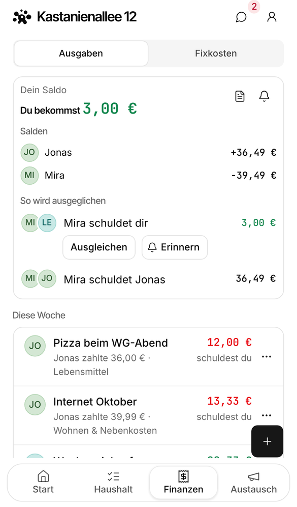
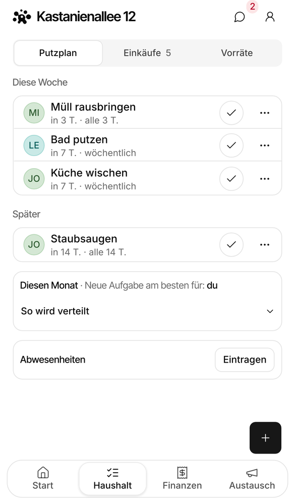
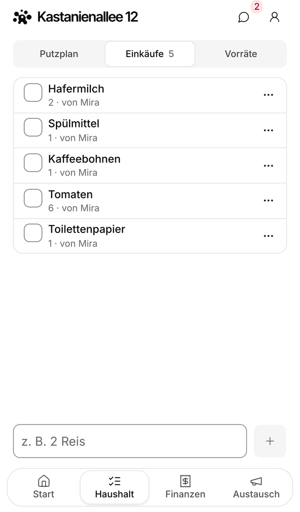

<p align="center"></p>

<h1 align="center">ManaWG</h1>

<p align="center">
  <strong>The free, open-source app for shared flats: split expenses, rotate chores, share the shopping list.</strong>
</p>

<p align="center">
  <a href="https://manawg.com">Website</a> ·
  <a href="https://app.manawg.com">Try it</a> ·
  <a href="#self-hosting">Self-host</a> ·
  <a href="#contributing">Contribute</a> ·
  <a href="https://github.com/Abuarchiv/manawg-app/discussions">Discussions</a>
</p>

<p align="center">
  <a href="https://github.com/Abuarchiv/manawg-app/actions/workflows/ci.yml"></a>
  <a href="LICENSE"></a>
  <a href="#self-hosting"></a>
  <a href="https://scorecard.dev/viewer/?uri=github.com/Abuarchiv/manawg-app"></a>
  <a href="https://github.com/Abuarchiv/manawg-app/stargazers"></a>
  <a href="https://github.com/Abuarchiv/manawg-app/discussions"></a>
</p>

<p align="center">
  
  
  
  
</p>

ManaWG is a free, open-source flatshare app for roommates and house shares: expense splitting and a
Splitwise alternative, a chore chart for the cleaning rota, and a shared shopping list in one place.
A *WG* (short for *Wohngemeinschaft*) is the German word for a shared flat, so you may also know
this kind of tool as a "WG app". It runs in the browser, installs on your phone as a PWA, and you
can use it at [app.manawg.com](https://app.manawg.com) or self-host it.

> The interface is currently in German. An English interface is in progress, see the
> [roadmap](#roadmap).

## Features

**Money**

- Split expenses evenly or by custom amounts and see who owes whom.
- Settle up with as few transfers as possible, and send payment reminders.
- Recurring costs such as rent and utilities, and a monthly statement by mail.
- Import from Splitwise or Splid (CSV), or from a screenshot; the text recognition runs in your
  browser.

**Chores**

- A cleaning rota that rotates between flatmates and takes absences into account.
- Reminders for chores that are due.

**Shared life**

- One shopping list for the flat that keeps working offline, plus a list of household supplies.
- A shared calendar with recurring dates, reminders and an iCal feed for your calendar app.
- A flat chat and a pinboard for announcements.

**Your data**

- Export a WG as JSON or CSV, and delete your account at any time.
- No ads and no tracking cookies; product analytics (PostHog) run cookieless.
- Up to 20 members per WG.

## Why ManaWG

A typical flat uses a bill splitter such as Splitwise for the money, a chore app for the cleaning
rota and a group chat for everything else. That works, but the pieces do not know about each
other: the person who is away still gets the bathroom, and the shopping list lives in a chat
scroll. ManaWG keeps expenses, chores, shopping, calendar and chat in one app for one flat.

- **Free, with nothing held back.** No ads, no paid plan, no locked feature.
- **Phone first.** It works in any browser, installs as a PWA, and the shopping list works
  offline.
- **Yours to keep.** Export everything, or run your own instance and keep the data on your own
  machine.
- **Open source.** Apache-2.0, developed in the open.

If you only need to split bills and your flat already likes Splitwise, you can import your history
and try ManaWG next to it.

## Self-hosting

A whole instance (app, database, sign-in, image storage) runs on any machine with Docker:

```sh
git clone https://github.com/Abuarchiv/manawg-app.git
cd manawg-app
./docker/setup.sh            # creates .env with fresh secrets
docker compose up -d
```

The first start builds the app image, which takes about ten minutes. Then open
[http://localhost](http://localhost) and create an account; the sign-in code arrives in Mailpit at
[http://localhost:8025](http://localhost:8025). The [self-hosting guide](docs/self-hosting.md) ([German](docs/self-hosting.de.md))
covers a public instance with your own domain and HTTPS, mail, updates, backups, and the
alternative setup on Vercel and Supabase.

## Tech stack

| Layer | Used |
| --- | --- |
| App | Next.js 16, React 19, TypeScript, Tailwind CSS 4, installable PWA |
| Data | PostgreSQL with Drizzle ORM |
| Accounts and files | Supabase Auth and Storage |
| Self-hosting | Docker Compose with Caddy |

[docs/architecture.md](docs/architecture.md) explains how the code is structured.

## Local development

You do not need a database or any accounts. With Node 22 and pnpm 9:

```sh
corepack enable
pnpm install
pnpm --filter @manawg/web dev:fixtures
```

Then open [localhost:3000/wg/MTE8PZAT](http://localhost:3000/wg/MTE8PZAT), a sample WG running on
fixture data. [docs/development.md](docs/development.md) lists all commands and tests.

## Contributing

Contributions are welcome: code, bug reports, documentation, translations and ideas.

- **Start small.** Issues labelled
  [good first issue](https://github.com/Abuarchiv/manawg-app/labels/good%20first%20issue) are
  scoped and described for a first pull request.
- **Pick something bigger.** Issues labelled
  [help wanted](https://github.com/Abuarchiv/manawg-app/labels/help%20wanted) are open to anyone.
- **Ask first.** Questions and ideas go to
  [Discussions](https://github.com/Abuarchiv/manawg-app/discussions).

[CONTRIBUTING.md](CONTRIBUTING.md) walks through your first pull request.

## Roadmap

- English interface (in progress)

## Community and support

- **Questions and ideas:** [Discussions](https://github.com/Abuarchiv/manawg-app/discussions).
- **Help and bug reports:** see [SUPPORT](.github/SUPPORT.md).
- **Security:** report vulnerabilities privately, see [SECURITY.md](SECURITY.md).

If ManaWG helps your flat, a star on GitHub is a kind way to say thanks and helps others find it.

## License

ManaWG is licensed under the [Apache License 2.0](LICENSE).
