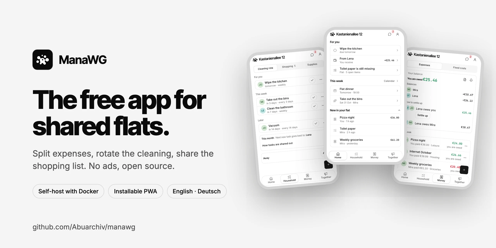
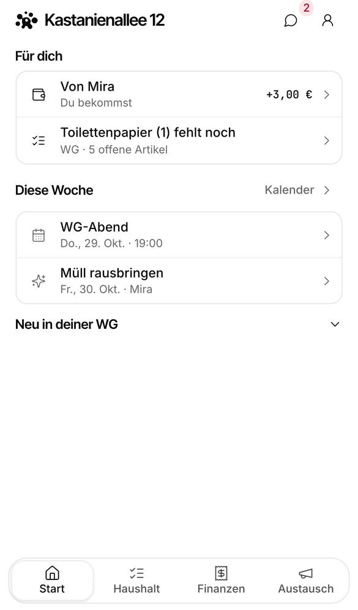
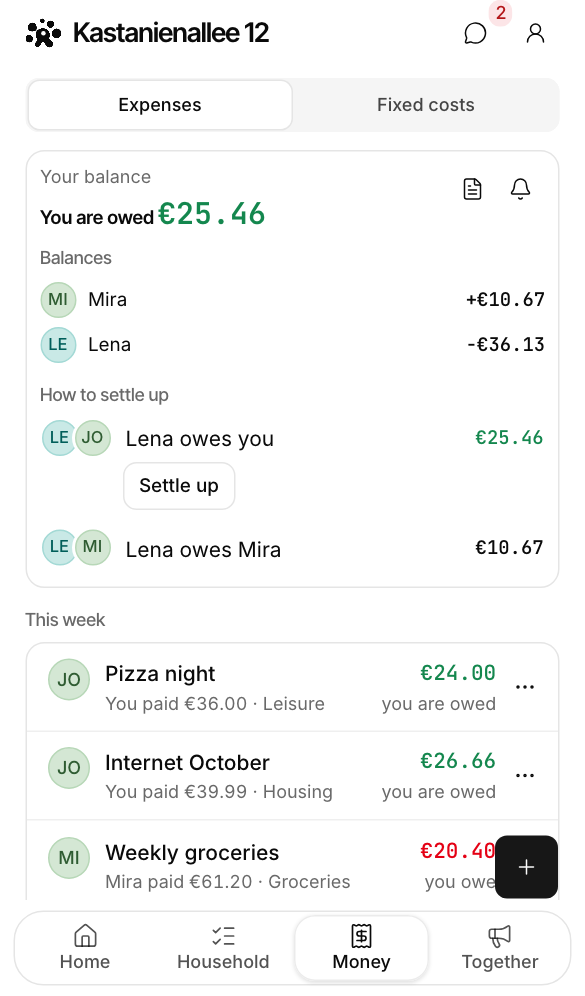
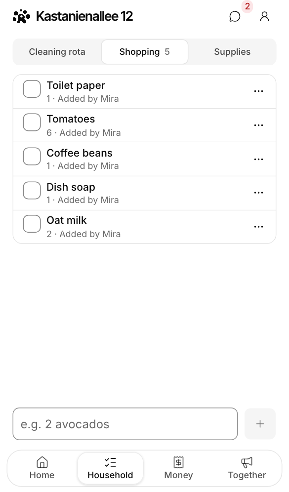
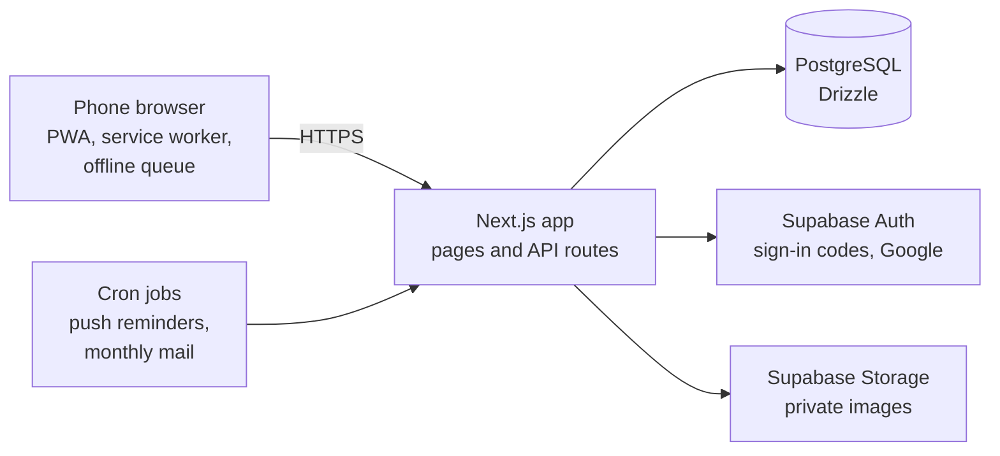

<p align="center">
  <a href="https://manawg.com/en">
    <picture>
      <source media="(prefers-color-scheme: dark)" srcset="docs/screenshots/cover-dark.webp">
      
    </picture>
  </a>
</p>

<p align="center">
  <a href="https://app.manawg.com"><strong>Use it free</strong></a> ·
  <a href="https://manawg.com/en">Live demo</a> ·
  <a href="#self-hosting">Self-host</a> ·
  <a href="docs/README.md">Docs</a> ·
  <a href="#contributing">Contribute</a> ·
  <a href="https://github.com/Abuarchiv/manawg/discussions">Discussions</a>
</p>

<p align="center">
  <a href="https://github.com/Abuarchiv/manawg/actions/workflows/ci.yml"></a>
  <a href="LICENSE"></a>
  <a href="#self-hosting"></a>
  <a href="https://scorecard.dev/viewer/?uri=github.com/Abuarchiv/manawg"></a>
  <a href="https://codespaces.new/Abuarchiv/manawg"></a>
</p>

**ManaWG** is the free, open-source app for shared flats. It keeps the expenses, cleaning rota,
shopping list, calendar and chat of a flat in one place, on every flatmate's phone. A *WG*
(*Wohngemeinschaft*) is the German word for a shared flat.

- **Expenses that settle themselves:** split evenly or by amount, see who owes whom, settle up
  in as few transfers as possible.
- **A cleaning rota that is fair:** chores rotate between flatmates and skip whoever is away.
- **One shopping list for the flat,** plus household supplies, a shared calendar, chat and
  pinboard.
- **An app without an app store:** install it from the browser on Android and iPhone; it keeps
  working offline.
- **Yours to run:** no ads, Apache-2.0, and one `docker compose up` for your own instance.

> [!TIP]
> No account needed to look around: the [live demo on manawg.com](https://manawg.com/en) ends with
> a phone showing the real app on sample data, and you can tap through it.

## Contents

[Features](#features) · [Why ManaWG](#why-manawg) · [Get started](#get-started) ·
[Self-hosting](#self-hosting) · [Develop](#develop) · [Feedback and roadmap](#feedback-and-roadmap) ·
[Contributing](#contributing) · [Translations](#translations) · [License](#license)

## Features

<p align="center">
  
  
  
  
</p>

| | |
| --- | --- |
| **Money** | Even or custom splits · balances and settle-up suggestions with as few transfers as possible · payment reminders · recurring costs such as rent and internet · a monthly statement by mail · import from Splitwise or Splid (CSV) or from a screenshot, with the text recognition running in your browser |
| **Chores** | Rotating cleaning rota · absences taken into account · reminders when a chore is due |
| **Shared life** | Shopping list and household supplies · calendar with recurring dates, reminders and an iCal feed · flat chat · pinboard for announcements |
| **On your phone** | Installable PWA on Android and iPhone · push notifications · offline: new expenses, chores, shopping items and announcements wait on the phone and sync without duplicates · English and German, following the device language |
| **Your data** | Export a WG as JSON or CSV · delete your account at any time · no ads, no tracking cookies · up to 20 members per WG |

## Why ManaWG

A typical flat uses a bill splitter such as Splitwise for the money, a chore app for the cleaning
rota and a group chat for everything else. That works, but the pieces do not know about each
other: the person who is away still gets the bathroom, and the shopping list lives in a chat
scroll. ManaWG keeps all of it in one app for one flat.

If you only need to split bills and your flat already likes Splitwise, import your history and try
ManaWG next to it.

What we hold on to:

- **Phone first.** Flatmates use it standing in the kitchen or the supermarket. Every screen is
  one column, on every screen size.
- **Small on purpose.** ManaWG is for one flat of up to 20 people, not for trips, offices or
  landlords. New features have to fit that.
- **Money is exact.** Amounts are integer cents, splits always add up to the total, and a request
  retried over a bad connection is never booked twice.
- **Private by default.** No ads, cookieless and minimal analytics on the hosted instance, none on
  yours.

## Get started

| | [app.manawg.com](https://app.manawg.com) | Your own instance |
| --- | --- | --- |
| **Setup** | Sign up with an email code or Google, create a WG, share the invite link | `./docker/setup.sh` and `docker compose up -d` on any machine with Docker |
| **Cost** | Free | Your server |
| **Updates** | Deployed for you from `main` | `git pull`, then rebuild; migrations run on start |
| **Data location** | Database and servers in Frankfurt, Germany (EU) | Wherever your server is |
| **Analytics** | Cookieless page views and counts of new and joined WGs, nothing else | Off |
| **Mail** | Included | Your SMTP server, or Mailpit for testing |

Either way the app is the same code from this repository.

## Self-hosting

A whole instance (app, database, sign-in, image storage, mail catcher) runs on any machine with
Docker:

```sh
git clone https://github.com/Abuarchiv/manawg.git
cd manawg
./docker/setup.sh            # creates .env with fresh secrets
docker compose up -d
```

The first start builds the app image, which takes about ten minutes. Then open
[http://localhost](http://localhost) and create an account; the sign-in code arrives in Mailpit at
[http://localhost:8025](http://localhost:8025).

The [self-hosting guide](docs/self-hosting.md) covers a public instance with your own domain and
HTTPS, mail, Google sign-in, updates, backups, and the alternative setup on Vercel and Supabase.

## Develop

You need neither a database nor accounts: fixture mode serves a sample WG from memory.

**In the browser:** open the repository in
[GitHub Codespaces](https://codespaces.new/Abuarchiv/manawg) (or any dev container) and run the
last command below.

**On your machine,** with Node 22 and pnpm 9:

```sh
corepack enable
pnpm install
pnpm --filter @manawg/web dev:fixtures
```

Then open [localhost:3000/wg/MTE8PZAT](http://localhost:3000/wg/MTE8PZAT).
[docs/development.md](docs/development.md) lists all commands, tests and quality gates.

<details>
<summary><strong>How it fits together</strong></summary>



| Layer | Used |
| --- | --- |
| App | Next.js 16, React 19, TypeScript, Tailwind CSS 4, installable PWA |
| Data | PostgreSQL with Drizzle ORM, versioned SQL migrations |
| Accounts and files | Supabase Auth and Storage |
| Tests | `node:test` unit tests, Playwright end to end |
| Self-hosting | Docker Compose with Caddy |

[docs/architecture.md](docs/architecture.md) explains the layers, the money model, idempotency
and the offline queue.

</details>

## Feedback and roadmap

ManaWG is in daily use at [app.manawg.com](https://app.manawg.com). There are no versioned
releases yet: `main` is always deployable, and the hosted instance runs it.

What gets built next is decided in the open:

- **Vote** with 👍 on the feature requests you want; the
  [most-voted list](https://github.com/Abuarchiv/manawg/issues?q=is%3Aissue+is%3Aopen+label%3Aenhancement+sort%3Areactions-%2B1-desc)
  is the roadmap.
- **Propose** something new in
  [Discussions → Ideas](https://github.com/Abuarchiv/manawg/discussions/categories/ideas), or as a
  [feature request](https://github.com/Abuarchiv/manawg/issues/new?template=feature_request.yml).
- **Criticise.** If something is confusing, slow or wrong,
  [say so](https://github.com/Abuarchiv/manawg/issues/new/choose). That is a contribution too.

## Contributing

Code, bug reports, documentation, translations and ideas are all welcome.

- **First time?** Issues labelled
  [good first issue](https://github.com/Abuarchiv/manawg/labels/good%20first%20issue) are small
  and written up for a first pull request. None open right now? Ask in
  [Discussions](https://github.com/Abuarchiv/manawg/discussions) and we will find one with you.
- **Something bigger?** Issues labelled
  [help wanted](https://github.com/Abuarchiv/manawg/labels/help%20wanted) are open to anyone.

[CONTRIBUTING.md](CONTRIBUTING.md) walks through your first pull request in five minutes of setup.
The website [manawg.com](https://manawg.com) is open source too:
[Abuarchiv/manawg-landing](https://github.com/Abuarchiv/manawg-landing).

Want to say thanks? A ⭐ helps other flats find ManaWG.

## Translations

ManaWG speaks English and German. Every text lives in a catalog under
`apps/web/src/shared/i18n/messages/`, one folder per language, so a wording fix is a one-line pull
request. Want ManaWG in your language? Open an issue labelled
[i18n](https://github.com/Abuarchiv/manawg/labels/i18n) and we will set it up together; see
[Texts and translations](CONTRIBUTING.md#texts-and-translations).

## Community and support

- **Questions and ideas:** [Discussions](https://github.com/Abuarchiv/manawg/discussions).
- **Help and bug reports:** see [SUPPORT](.github/SUPPORT.md).
- **Security:** report vulnerabilities privately, see [SECURITY.md](SECURITY.md).
- **Conduct:** everyone taking part follows the [Code of Conduct](CODE_OF_CONDUCT.md).

## License

ManaWG is licensed under the [Apache License 2.0](LICENSE). Third-party components and their
licences: [THIRD-PARTY-NOTICES.md](THIRD-PARTY-NOTICES.md).
